# TP4 Spring Cloud : Microservices « Calculatrice » avec Eureka, Gateway et OpenFeign

| | |
|---|---|
| **Établissement** | Faculté des Sciences de Sfax, Département d'informatique et des Communications |
| **Matière** | Architecture MicroServices |
| **Filière** | MPSRCC1 |
| **Enseignantes** | Corinne Amel ZAYANI, Amal ABID |
| **Année universitaire** | 2026-2027 |
| **Étudiant(e)** | Najar Amina |

 
---

## Sommaire

1. [Objectif du TP](#1-objectif-du-tp)
2. [Architecture réalisée](#2-architecture-réalisée)
3. [Partie A : Questions de conception](#3-partie-a--questions-de-conception)
4. [Partie B : L'annuaire eureka-service](#4-partie-b--lannuaire-eureka-service)
5. [Partie C : Enregistrement des microservices](#5-partie-c--enregistrement-des-microservices)
6. [Partie D : OpenFeign](#6-partie-d--openfeign)
7. [Partie E : La passerelle gateway-service](#7-partie-e--la-passerelle-gateway-service)
8. [Questions de synthèse](#8-questions-de-synthèse)
9. [Captures restant à ajouter](#9-captures-restant-à-ajouter)
---

## 1. Objectif du TP

Au TP3, la calculatrice était découpée en deux microservices (`calcul-service` sur le port 8081 et `historique-service` sur le port 8082) qui communiquaient avec une adresse écrite en dur. Cette architecture présentait trois faiblesses :

1. l'adresse de `calcul-service` est figée dans `application.properties` ;
2. le client doit connaître l'adresse de chaque microservice ;
3. aucune répartition de charge n'est possible entre plusieurs instances.
   Ce TP les corrige avec **Spring Cloud** :

| Composant | Rôle dans le TP |
|---|---|
| **Eureka Server** | Annuaire des services (service registry), port 8761 |
| **Eureka Client** | Inscription automatique et découverte des services |
| **Spring Cloud LoadBalancer** | Choix d'une instance à tour de rôle (round robin) |
| **OpenFeign** | Client REST déclaratif dans `historique-service` |
| **Spring Cloud Gateway** | Point d'entrée unique des clients, port 8888 |
| **springdoc-openapi** | Swagger UI pour documenter et tester chaque service |
| **Lombok** | Génération des constructeurs, getters et setters |

Environnement : Spring Boot 4.0.9, Spring Cloud 2025.1.x, IntelliJ IDEA, projet Maven multi-modules.
 
---

## 2. Architecture réalisée

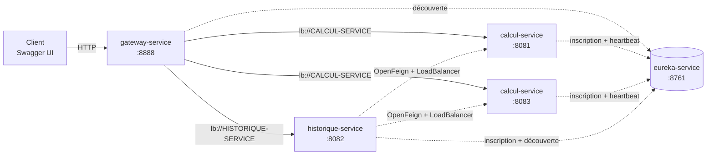

| Programme | Port | Rôle |
|---|---|---|
| eureka-service | 8761 | Annuaire des services |
| calcul-service (instance 1) | 8081 | Quatre opérations de calcul |
| calcul-service (instance 2) | 8083 | Second exemplaire du même programme |
| historique-service | 8082 | Enregistrement des opérations, appelle calcul-service |
| gateway-service | 8888 | Passerelle, point d'entrée unique |

Ordre de lancement : `eureka-service` → `calcul-service` → `historique-service` → `gateway-service`.

### Organisation du projet IntelliJ

Un seul projet `calculatrice-spring-cloud` avec un `pom.xml` parent (packaging `pom`) qui regroupe quatre modules Maven, un par microservice.

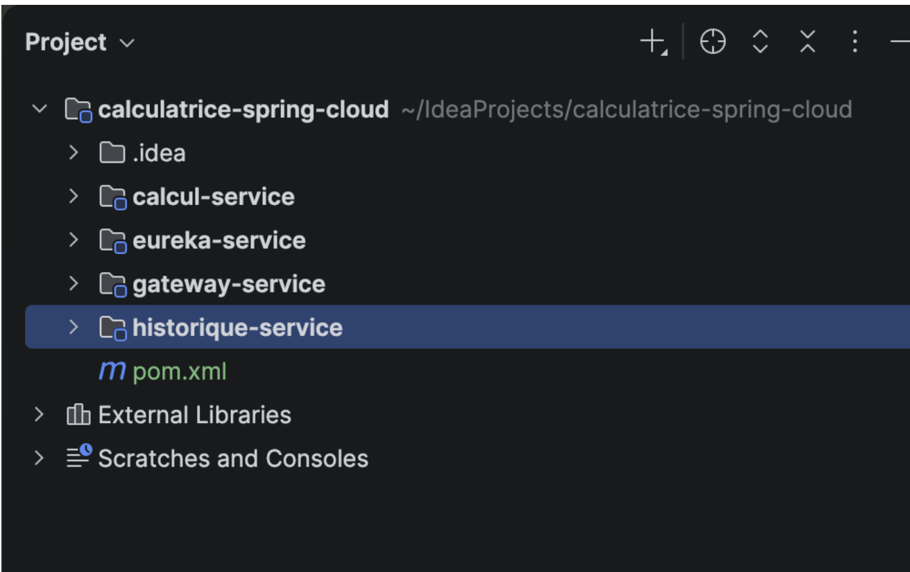

*figure 01 : Structure du projet*

Contenu de chaque module :

| Module | Capture |
|---|---|
| eureka-service | <br>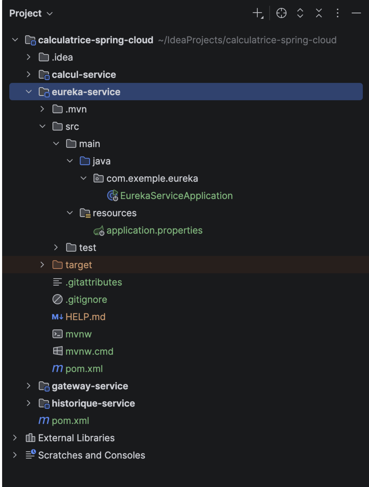 |
| calcul-service | <br>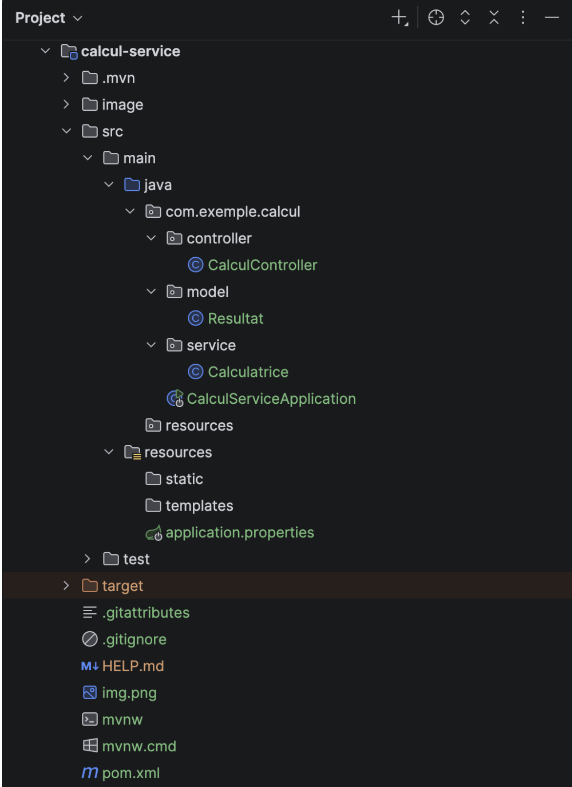 |
| historique-service |<br>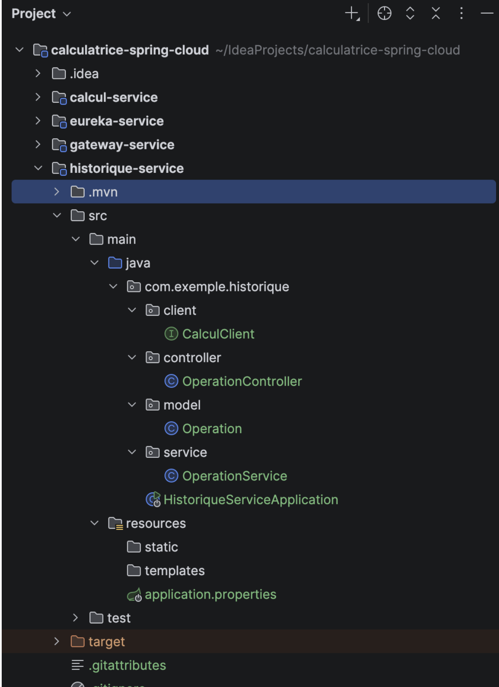 |
| gateway-service | <br>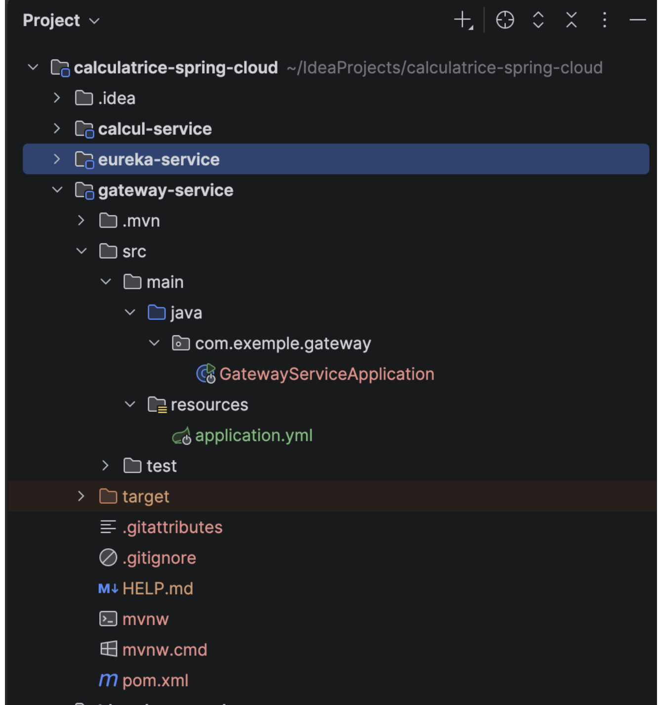 |

On remarque dans `historique-service` que `CalculClient` est désormais une **interface** (icône « I ») : OpenFeign génère son implémentation.
 
---

## 3. Partie A : Questions de conception

**A.4.1. Quel composant fait la correspondance entre le nom et les adresses, et quand est-elle mise à jour ?**

C'est **Eureka Server** (l'annuaire) qui associe un nom de service (`CALCUL-SERVICE`) aux adresses de ses instances. La correspondance est mise à jour à l'inscription d'une instance (au démarrage), par les battements de cœur (heartbeats) envoyés régulièrement, à la désinscription (arrêt propre) et à l'éviction (instance qui n'envoie plus de heartbeat). Chaque client en garde une copie locale, rafraîchie périodiquement (toutes les 5 s avec la configuration du TP).

**A.4.2. Avantage et inconvénient du point d'entrée unique ?**

- *Avantage* : le client ne connaît qu'une adresse (port 8888), quel que soit le nombre de microservices ; on peut y centraliser sécurité, journalisation et routage.
- *Inconvénient* : la passerelle devient un point de défaillance unique et un goulot d'étranglement potentiel, et elle ajoute un saut réseau à chaque requête.
  **A.4.3. Six requêtes `GET :8888/calcul/somme?a=1&b=1` avec deux instances (8081 et 8083) : combien chacune en reçoit-elle ? Le client le voit-il ?**

Avec la stratégie à tour de rôle, chaque instance reçoit **3 requêtes**. Le client ne peut pas s'en apercevoir : la réponse est la même (`2`) quelle que soit l'instance. Seules les traces dans les consoles des deux instances le montrent.
 
---

## 4. Partie B : L'annuaire eureka-service

### Mise en œuvre

- Module généré avec Spring Initializr (dépendance **Eureka Server**).
- Annotation `@EnableEurekaServer` sur la classe principale `EurekaServiceApplication`.
- Configuration (`application.properties`) :
```properties
spring.application.name=eureka-service
server.port=8761
eureka.client.register-with-eureka=false
eureka.client.fetch-registry=false
eureka.server.eviction-interval-timer-in-ms=5000
eureka.server.enable-self-preservation=false
```

Le serveur ne s'enregistre pas lui-même (`register-with-eureka=false`) et ne télécharge pas le registre (`fetch-registry=false`). L'éviction rapide et la désactivation de l'auto-préservation rendent les expériences observables en quelques secondes (réglages de TP, à ne pas garder en production).

### Tableau de bord au démarrage

Après lancement, `http://localhost:8761` affiche **« No instances available »** : aucun microservice n'est encore inscrit. Le message rouge sur l'auto-préservation désactivée est le résultat attendu de `enable-self-preservation=false`.

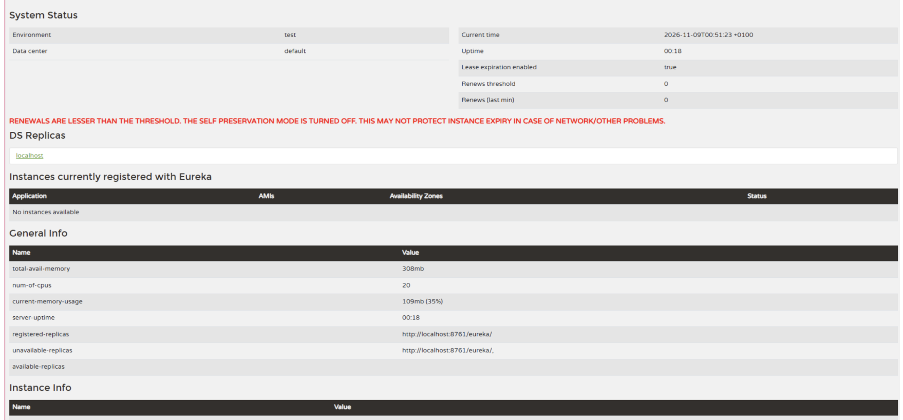

*Capture 06 : Eureka vide*

**Question B.1. Pourquoi l'annuaire peut-il tourner sur le même poste que les autres services sans conflit ?**

Chaque programme est une application Spring Boot indépendante, lancée dans **sa propre JVM** avec **son propre Tomcat** et **son propre port** (8761, 8081, 8082...). Il n'y a pas de conflit tant que deux programmes n'utilisent pas le même port.
 
---

## 5. Partie C : Enregistrement des microservices

### Intégration des projets du TP3

Les dossiers `calcul-service` et `historique-service` du TP3 ont été copiés dans le projet parent et déclarés comme modules dans le `pom.xml` racine.

### Ajouts dans `pom.xml` (calcul-service et historique-service)

- propriété `spring-cloud.version` et bloc `<dependencyManagement>` (BOM `spring-cloud-dependencies`) ;
- `spring-cloud-starter-netflix-eureka-client` ;
- `springdoc-openapi-starter-webmvc-ui` (Swagger UI, version 3.0.x) ;
- `lombok` (optionnel) déclaré comme processeur d'annotations et exclu du jar ;
- `spring-cloud-starter-openfeign` dans `historique-service` (partie D).
### Lombok

Les classes de données `Resultat` (calcul-service) et `Operation` (historique-service) utilisent `@Getter @Setter @NoArgsConstructor @AllArgsConstructor @ToString` à la place des constructeurs, getters et setters écrits à la main.

### Configuration de calcul-service

```properties
spring.application.name=calcul-service
server.port=8081
eureka.client.service-url.defaultZone=http://localhost:8761/eureka
eureka.instance.instance-id=${spring.application.name}:${server.port}
eureka.instance.prefer-ip-address=true
eureka.instance.lease-renewal-interval-in-seconds=5
eureka.instance.lease-expiration-duration-in-seconds=10
server.forward-headers-strategy=framework
```

Dans `CalculController`, chaque méthode affiche une trace avec le port de l'instance, par exemple `[calcul-service:8081] somme 2+3`, pour observer la répartition de charge.

### C.4 Démarrage et inscription

La console montre l'enregistrement de `CALCUL-SERVICE` auprès d'Eureka, puis `Tomcat started on port 8081` et `Started CalculServiceApplication`. La trace `[calcul-service:8081] somme 2+3` confirme que le service répond.

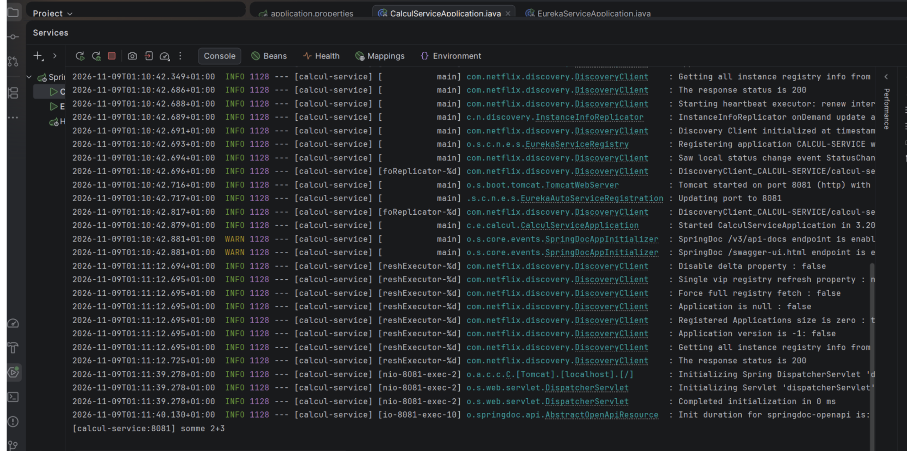

*Capture 13 : Console calcul-service 8081*

Swagger UI (`http://localhost:8081/swagger-ui.html`) liste les opérations de `calcul-controller`, générées automatiquement par springdoc à partir des annotations du contrôleur, avec l'adresse de serveur `http://localhost:8081`.

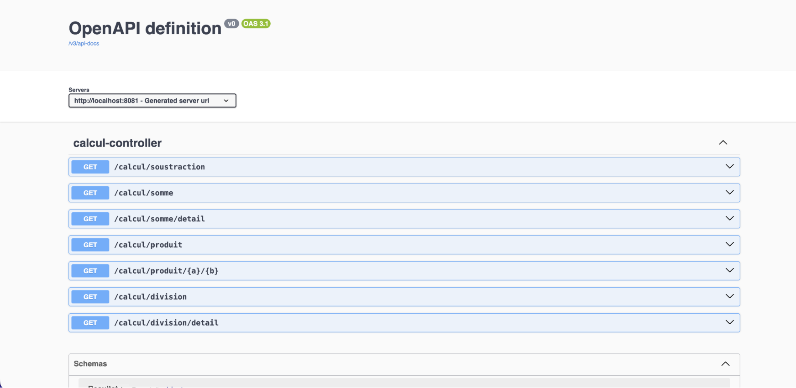

*Capture 07 : Swagger UI calcul-service*

Tests directs sur calcul-service via Swagger UI :

| Requête | Résultat | Capture |
|---|---|---|
| `GET /calcul/somme?a=3&b=5` | 200, `8` | **Capture 08**<br>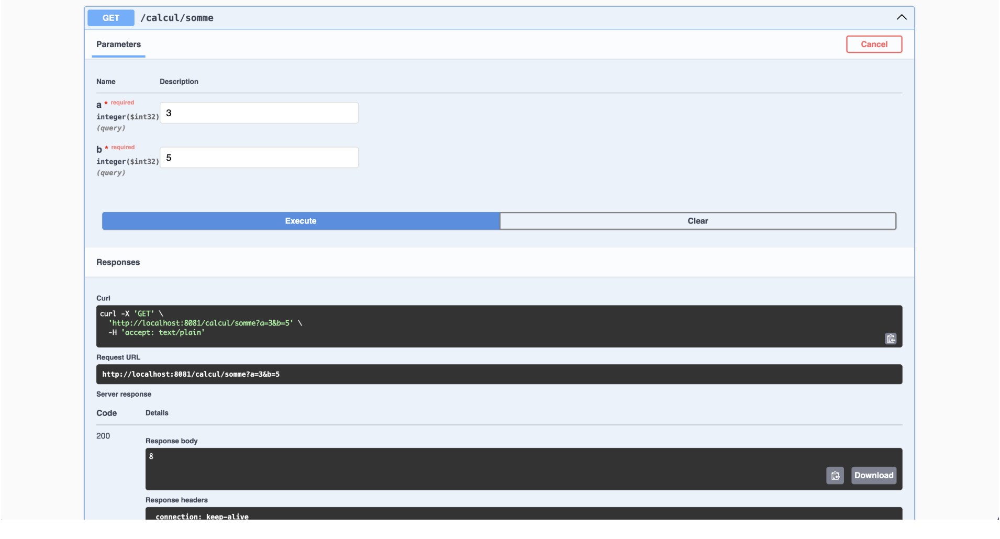 |
| `GET /calcul/produit?a=6&b=7` | 200, `42` | **Capture 10**<br>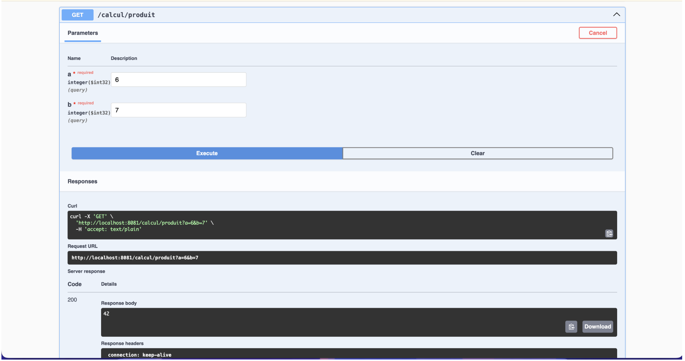 |
| `GET /calcul/division?a=7&b=2` | 200, `3.5` | **Capture 11**<br>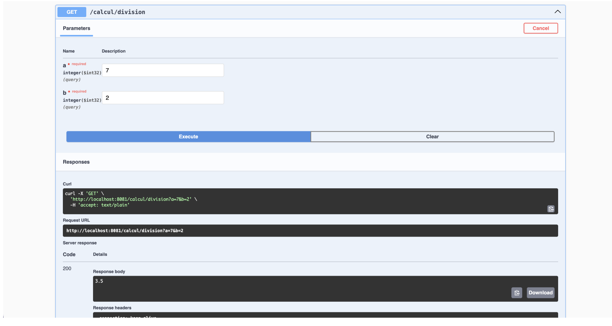 |
| `GET /calcul/division?a=7&b=0` | **400**, `Erreur : division par 0 impossible` | **Capture 12**<br>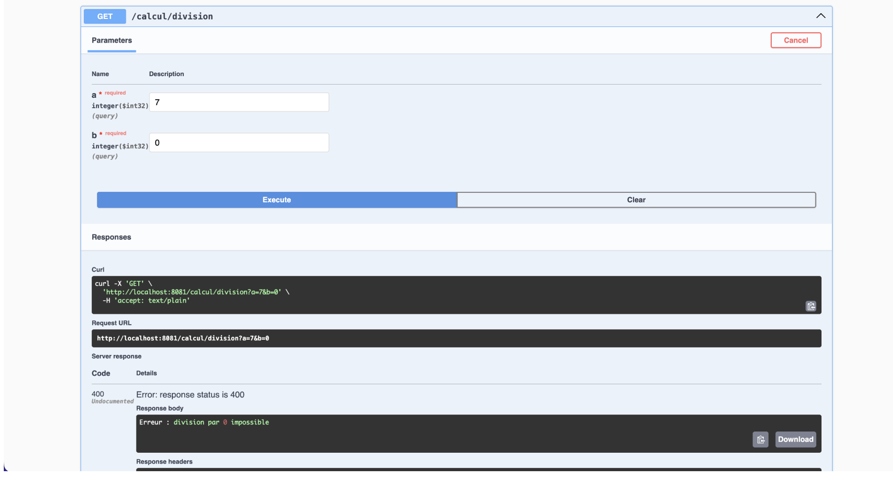 |

Traces dans la console de l'instance 8081 pour ces appels :

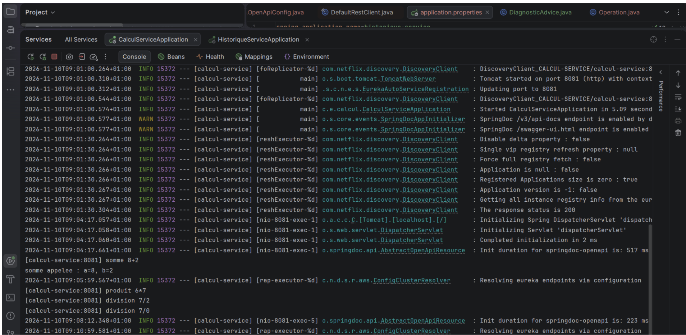

*Capture 14 : Traces instance 8081*

### C.5 Seconde instance sur le port 8083

La seconde instance est lancée depuis une configuration IntelliJ dédiée `CalculServiceApplication 8083` avec l'argument `--server.port=8083` (l'option de la ligne de commande l'emporte sur `application.properties`). Le tableau de bord Eureka affiche alors **`CALCUL-SERVICE UP (2)`** avec `calcul-service:8083` et `calcul-service:8081`.

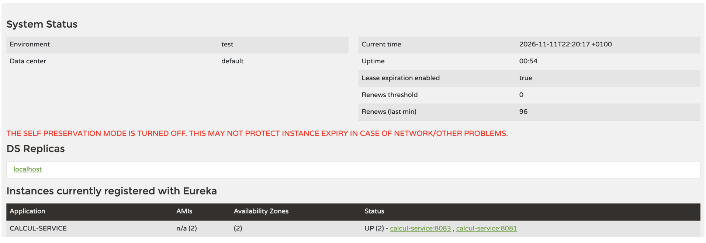

*Capture 09 : Eureka avec 2 instances*

La fenêtre **Services** d'IntelliJ montre les programmes en cours : `CalculServiceApplication :8081`, `CalculServiceApplication 8083 :8083`, `EurekaServiceApplication :8761` et `HistoriqueServiceApplication :8082`. La console de l'instance 8083 contient bien les traces `[calcul-service:8083] ...`.

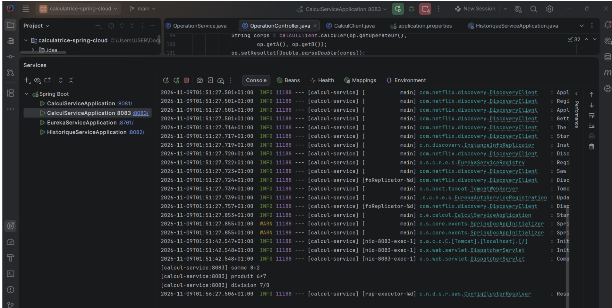

*Capture 15 : Services IntelliJ avec instance 8083*

**Question C.1. À quoi servent le nom commun et l'identifiant différent des deux instances ?**

Le **nom** (`CALCUL-SERVICE`) est ce que l'appelant utilise pour désigner le service logique, sans connaître ses adresses. L'**identifiant d'instance** (`calcul-service:8081`, `calcul-service:8083`) distingue chaque exemplaire dans l'annuaire : c'est parmi eux que LoadBalancer choisit, et c'est lui qu'Eureka utilise pour renouveler le bail ou retirer une instance.

**Question C.2. Que se passerait-il sans l'option `--server.port=8083` ?**

La seconde instance essaierait de démarrer sur le port 8081 déjà occupé par la première : le démarrage échouerait (`Port 8081 was already in use`). Elle aurait en plus le même identifiant d'instance, ce qui prêterait à confusion dans l'annuaire.

### C.6 Expérience : arrêt d'une instance

Lors d'un arrêt propre, le client Eureka envoie une désinscription et l'instance disparaît de l'annuaire (`UP (1)`). Si le processus est tué brutalement, l'annuaire retire l'instance après `lease-expiration-duration-in-seconds` (10 s) à sa vérification suivante (5 s). Au redémarrage, l'instance réapparaît dès son lancement.

> 📸 *Capture à ajouter : `images/20-eureka-apres-arret-8083.png` (CALCUL-SERVICE UP (1)).*
 
---

## 6. Partie D : OpenFeign

### Mise en œuvre

1. `@EnableFeignClients` sur `HistoriqueServiceApplication`.
2. La classe `CalculClient` du TP3 (RestClient + adresse en dur) est remplacée par une **interface** :
```java
@FeignClient(name = "CALCUL-SERVICE")
public interface CalculClient {
    @GetMapping("/calcul/{operateur}")
    String calculer(@PathVariable("operateur") String operateur,
                    @RequestParam("a") int a,
                    @RequestParam("b") int b);
}
```

3. Dans `OperationController`, les exceptions `HttpClientErrorException` et `ResourceAccessException` sont remplacées par `FeignException.BadRequest` (service appelé répond 400, la sous-classe d'abord) et `FeignException` (service injoignable, 503).
   La propriété `calcul.service.url` a disparu : l'adresse est obtenue à partir du nom grâce à Eureka et à LoadBalancer.

### Tests

> 📸 *Captures à ajouter (Swagger UI de `localhost:8082`, avec Request URL, Code, Response body et Response headers visibles, dont `Location` pour les POST) :*
>
> | N° | Requête | Statut attendu |
> |---|---|---|
> | 1 | `POST /operations` `{"operateur":"somme","a":8,"b":2}` | 201, résultat 10.0 |
> | 2 | `POST /operations` `{"operateur":"produit","a":6,"b":7}` | 201, résultat 42.0 |
> | 3 | `POST /operations` `{"operateur":"division","a":7,"b":2}` | 201, résultat 3.5 |
> | 4 | `POST /operations` `{"operateur":"division","a":7,"b":0}` | 400, `Erreur : division par 0 impossible` |
> | 5 | `POST /operations` `{"operateur":"racine","a":9,"b":0}` | 400, `Operateur inconnu : racine` |
> | 6 | `GET /operations` | 200, tableau JSON |
> | 7 | `GET /operations/2` | 200 |

Les consoles des instances 8081 et 8083 montrent des traces pour ces opérations : `historique-service` n'a jamais connu les ports 8081 et 8083, il a appelé le nom `CALCUL-SERVICE` et LoadBalancer a choisi l'instance.

**Question D.1. Six envois de la requête 1 : quelle règle de choix ? Quel nom pour cette stratégie ?**

Les appels alternent entre les deux instances : 8081, 8083, 8081, 8083... soit 3 requêtes chacune. La stratégie s'appelle **round robin** (tour de rôle), celle par défaut de Spring Cloud LoadBalancer.

> 📸 *Capture à ajouter : les deux consoles côte à côte après six envois (`images/21-alternance-8081-8083.png`).*

**Question D.2. Nom volontairement faux `CALCULSERVIC` : quel statut, quel bloc catch ?**

On obtient un **503** (Service Unavailable). Aucune instance n'est connue de l'annuaire sous ce nom, donc LoadBalancer répond 503 ; Feign lève une `FeignException` qui n'est pas une `BadRequest`. La réponse est donc produite par le **second bloc catch** (`catch (FeignException e)`), avec le message `calcul-service injoignable`.

> 📸 *Capture à ajouter : `images/22-d2-erreur-503.png`.*
 
---

## 7. Partie E : La passerelle gateway-service

### Mise en œuvre

Module `gateway-service` avec les dépendances `spring-cloud-starter-gateway-server-webflux` (variante réactive, serveur Netty), `spring-cloud-starter-netflix-eureka-client`, `spring-boot-starter-actuator` et `springdoc-openapi-starter-webflux-ui`. Pas de Tomcat, pas de Lombok.

Trois façons de définir les routes ont été étudiées :

| Étape | Mode | Principe |
|---|---|---|
| E.2 | Statique, YAML, adresses fixes | `uri: http://localhost:8081` : une seule instance utilisée |
| E.3 | Statique, YAML, `lb://` | `uri: lb://CALCUL-SERVICE` : répartition entre instances |
| E.4 | Statique, Java | bean `RouteLocator` équivalent au YAML |
| E.5 | **Dynamique** | une route créée automatiquement par service de l'annuaire |

Configuration de la découverte dynamique (E.5) :

```yaml
spring:
  cloud:
    gateway:
      server:
        webflux:
          discovery:
            locator:
              enabled: true
              lower-case-service-id: true
```

En mode dynamique, les URI vues du client contiennent le nom du service en premier segment (`/calcul-service/calcul/somme`, `/historique-service/operations`), et la passerelle retire ce préfixe avant de transmettre la requête.

### Annuaire avec les trois services

Eureka affiche `CALCUL-SERVICE UP (2)` (8083 et 8081), `GATEWAY-SERVICE UP (1)` (8888) et `HISTORIQUE-SERVICE UP (1)` (8082).

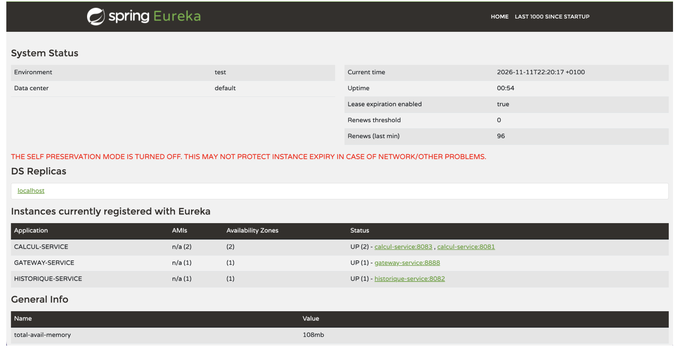

*Capture 18 : Eureka avec les trois services*

### Requêtes via la passerelle (configuration dynamique, E.5)

`GET http://localhost:8888/historique-service/operations` : la passerelle transmet `GET /operations` à `historique-service`. Réponse 200 avec la liste des opérations enregistrées.

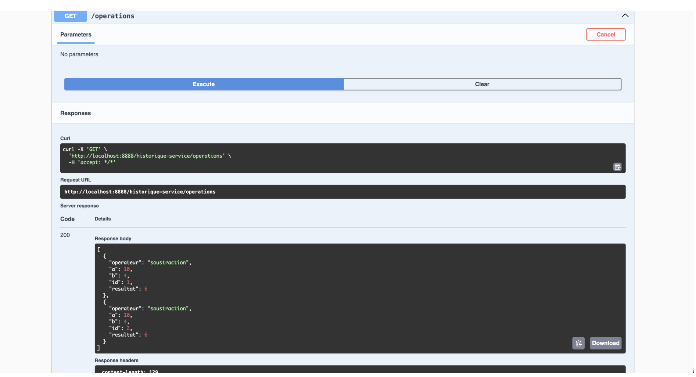

*Capture 16 : GET /operations via la passerelle*

`GET http://localhost:8888/historique-service/operations/2` : réponse 200 avec l'opération numéro 2.

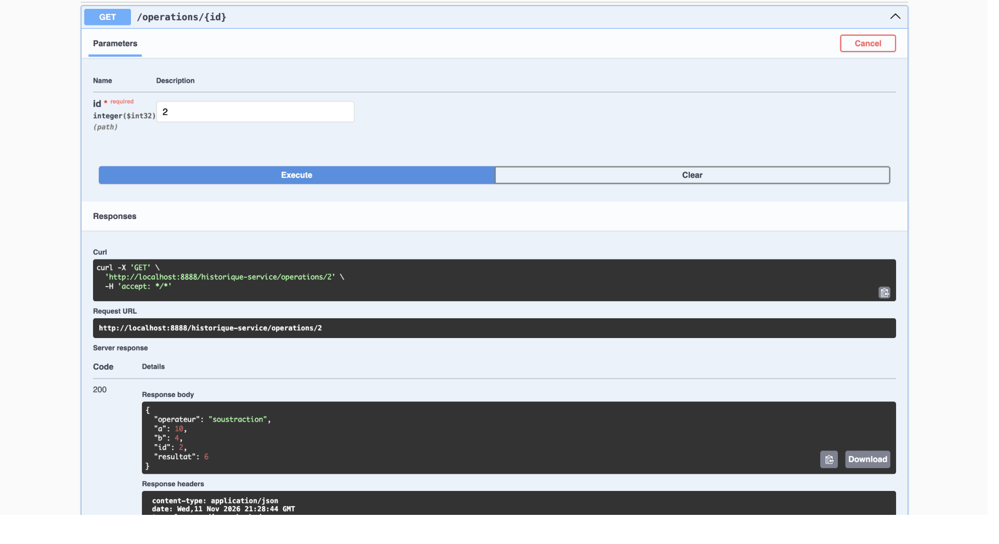

*Capture 17 : GET /operations/2 via la passerelle*

### Routes créées dynamiquement

`http://localhost:8888/actuator/gateway/routes` liste une route par service de l'annuaire (`ReactiveCompositeDiscoveryClient_CALCUL-SERVICE`, `..._GATEWAY-SERVICE`, `..._HISTORIQUE-SERVICE`). Chacune a un prédicat `Path` (`/calcul-service/**`, ...), un filtre `RewritePath` qui retire le préfixe et une destination `lb://NOM-DU-SERVICE`.

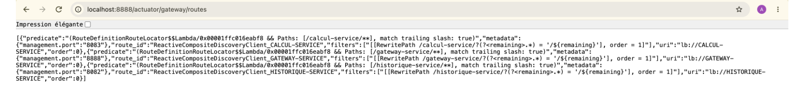

*Capture 19 : Routes dynamiques*

### Captures restant à ajouter pour la partie E

> 📸 *Console de la passerelle (`Netty started on port 8888`) ; Swagger UI de la passerelle en configuration statique et dynamique (liste « Select a definition » et zone Servers) ; les six requêtes des tableaux E.2 et E.5 ; l'alternance 8081 / 8083 avec `lb://` ; les cinq consoles avec les ports 8761, 8081, 8083, 8082 et 8888.*

**Question E.1. Pourquoi l'en-tête `Location` d'un POST indique-t-il le port 8888 et non 8082 ?**

La passerelle ajoute à la requête transmise les en-têtes `X-Forwarded-Host`, `X-Forwarded-Port` (et `X-Forwarded-Proto`, `X-Forwarded-Prefix` en mode dynamique) qui décrivent l'adresse vue par le client. Avec `server.forward-headers-strategy=framework`, `historique-service` utilise ces en-têtes : `ServletUriComponentsBuilder.fromCurrentRequest()` reconstruit donc l'adresse `http://localhost:8888/...` au lieu de `http://localhost:8082/...`.

**Question E.2. Comparaison des URI de E.3 et E.5 ; avantages ; laquelle oblige à modifier la passerelle ?**

| | E.3 (routes statiques `lb://`) | E.5 (routes dynamiques) |
|---|---|---|
| URI client | `/calcul/somme?a=2&b=3` | `/calcul-service/calcul/somme?a=2&b=3` |
| Avantage | URI propres, indépendantes du nom technique du service ; contrôle total sur ce qui est exposé | Aucune configuration : un nouveau service est routé dès son inscription |
| Inconvénient | Une route à écrire par service | Le nom du service apparaît dans l'URI ; tous les services sont exposés |

C'est la forme **statique (E.3)** qui oblige à modifier la passerelle à chaque ajout de microservice.

**Question E.3. Pourquoi la passerelle a-t-elle une route vers elle-même ? Est-ce gênant ?**

La passerelle est elle-même enregistrée dans Eureka (`GATEWAY-SERVICE`). Le localisateur dynamique crée une route pour **chaque** service de l'annuaire, donc aussi pour elle-même (visible dans les routes ci-dessus). Ce n'est pas gênant pour le TP, mais en production elle expose inutilement ses propres points d'accès (par exemple Actuator) : on exclut alors ce service du localisateur ou on le sécurise.
 
---

## 8. Questions de synthèse

**1. Pour chaque ligne du tableau A.3, étape où la différence a été observée.**

| Aspect | Étape |
|---|---|
| Nombre de programmes | B (annuaire), E (passerelle), C.5 (seconde instance) |
| Dépendances Maven | B.2, C.1, C.7, E.1 |
| Adresse d'un microservice | C.2, C.7 (propriété supprimée), D.2 |
| Appel entre microservices | D.2 (interface `@FeignClient`) |
| Erreurs d'appel | D.3, D.4 (requêtes 4 et 5), D.2 |
| Point d'entrée du client | E.2 à E.5 |
| Plusieurs instances | C.5, D.4, E.3 |
| Serveur embarqué | E.1 (Netty pour la passerelle, Tomcat ailleurs) |
| Arrêt d'un microservice | C.6, D.2 |
| Organisation du code | B.0, C.0 |
| Outil de test | C.4, D.4, E |
| Classes de données | C.1 bis, C.7 (Lombok) |

**2. Trajet de `POST :8888/historique-service/operations` avec `{"operateur":"somme","a":1,"b":2}`.**

1. Le client (Swagger UI) envoie la requête à la **passerelle** (8888).
2. La passerelle fait correspondre le prédicat `Path=/historique-service/**`, consulte sa copie locale de l'annuaire pour les instances de `HISTORIQUE-SERVICE`, en choisit une (LoadBalancer), retire le préfixe (`RewritePath`) et ajoute les en-têtes `X-Forwarded-*`.
3. Elle envoie `POST /operations` à **historique-service** (8082).
4. `OperationController` appelle `calculClient.calculer("somme", 1, 2)` : OpenFeign construit `GET /calcul/somme?a=1&b=2`, LoadBalancer choisit une instance de `CALCUL-SERVICE` (8081 ou 8083) d'après la copie locale de l'annuaire.
5. **calcul-service** répond `3` en texte brut.
6. `historique-service` convertit en `3.0`, attribue un id, enregistre l'opération et répond **201** avec l'opération et l'en-tête `Location`.
7. La réponse remonte par la passerelle jusqu'au client.
   Les consultations de l'annuaire se font sur la copie locale (rafraîchie toutes les 5 s), pas à chaque requête.

**3. Trois programmes contiennent un répartiteur de charge. Lesquels et quel nom résolvent-ils ?**

Le LoadBalancer est inclus avec le client Eureka, présent dans :
- **historique-service** : résout `CALCUL-SERVICE` (appels OpenFeign) ;
- **gateway-service** : résout `CALCUL-SERVICE` et `HISTORIQUE-SERVICE` (et `GATEWAY-SERVICE` en mode dynamique) via `lb://` ;
- **calcul-service** : il est présent (via le client Eureka) mais ne l'utilise pas, car il n'appelle aucun autre service.
  **4. Client Eureka, OpenFeign, Spring Cloud Gateway : nécessaires où et pourquoi ?**

| Dépendance | calcul-service | historique-service | gateway-service |
|---|---|---|---|
| Client Eureka | Oui : s'inscrire | Oui : s'inscrire et découvrir calcul-service | Oui : découvrir les services pour `lb://` |
| OpenFeign | Non | Oui : seul service qui en appelle un autre | Non : la passerelle route, elle n'appelle pas via une interface |
| Spring Cloud Gateway | Non | Non | Oui : c'est la passerelle |

**5. Réponse complète à la question 5 du TP3 (adresse en dur et répartition de charge).**

Avec une adresse en dur, `historique-service` appelle toujours la même instance, même si trois exemplaires de `calcul-service` tournent ; changer de port ou de machine impose de modifier la configuration et de relancer le service. Ce TP résout le problème : chaque instance s'inscrit dans **Eureka** sous le nom `CALCUL-SERVICE`, **OpenFeign** désigne le service par son nom, et **Spring Cloud LoadBalancer** choisit une instance différente à chaque appel (round robin). La **passerelle** applique le même principe pour les clients avec `lb://`.

**6. Deux instances d'historique-service (8082 et 8084) derrière la passerelle : que renvoie `GET /historique-service/operations` après trois POST ?**

Chaque instance garde ses opérations **en mémoire**. Les trois POST sont répartis entre les deux instances (par exemple 2 sur l'une et 1 sur l'autre) : le GET renverra une liste **partielle et différente selon l'instance** qui répond. Le principe mis en défaut est celui des services **sans état** (stateless) : l'état doit être externalisé. Correction : stocker les opérations dans une base de données (H2 partagée en serveur, PostgreSQL, MySQL...) ou un cache distribué commun aux instances.

**7. Construire et lancer les cinq programmes sans IntelliJ.**

```bash
# À la racine de calculatrice-spring-cloud : construit les quatre modules
mvn clean package -DskipTests
 
# Un terminal par programme, dans cet ordre
java -jar eureka-service/target/eureka-service-0.0.1-SNAPSHOT.jar
java -jar calcul-service/target/calcul-service-0.0.1-SNAPSHOT.jar
java -jar calcul-service/target/calcul-service-0.0.1-SNAPSHOT.jar --server.port=8083
java -jar historique-service/target/historique-service-0.0.1-SNAPSHOT.jar
java -jar gateway-service/target/gateway-service-0.0.1-SNAPSHOT.jar
```

**8. Rôle de `@GetMapping("/calcul/{operateur}")` dans `CalculController` et dans `CalculClient`.**

Dans `CalculController` (côté serveur), l'annotation **déclare** un point d'accès : elle décrit les requêtes **reçues**. Dans `CalculClient` (interface Feign, côté client), la même annotation **décrit la requête à envoyer** : OpenFeign la lit pour construire l'appel HTTP vers le service distant.

**9. Le regroupement en modules remet-il en cause l'indépendance des microservices ?**

Non. Chaque microservice conserve : sa **JVM** propre, son **port** propre, son **fichier .jar** propre (son propre `pom.xml`) et son **cycle de vie** indépendant (lancement, arrêt, redéploiement sans toucher aux autres). Le regroupement est purement organisationnel (une fenêtre IntelliJ, une commande Maven à la racine).

**10. D'où vient l'adresse de la zone Servers de Swagger UI ? Que se passerait-il sans `server.forward-headers-strategy=framework` ?**

Elle est construite par le microservice à partir des en-têtes `X-Forwarded-Host`, `X-Forwarded-Port` et `X-Forwarded-Prefix` ajoutés par la passerelle (d'où `http://localhost:8888` en statique et `http://localhost:8888/calcul-service` en dynamique). Sans cette propriété, le microservice ignorerait ces en-têtes et indiquerait sa propre adresse (`http://localhost:8081`) : Swagger UI enverrait alors ses requêtes **directement** au microservice, en contournant la passerelle (et le préfixe de service en mode dynamique ferait échouer les appels).

**11. Où se trouvent les méthodes générées par Lombok ? Pourquoi Lombok peut-il être exclu du .jar ?**

Lombok intervient **à la compilation** : il ajoute constructeurs, getters et setters directement dans le fichier **`.class`** (par exemple `Operation.class` dans `target/classes`), qu'on peut voir avec la fenêtre Structure d'IntelliJ ou un décompilateur. Le code source ne contient que les attributs. À l'exécution, les méthodes sont déjà dans le bytecode, Lombok n'est plus utile : on l'exclut donc du `.jar` exécutable.
 
---

## 9. Captures restant à ajouter

Captures encore à faire pour compléter le compte rendu (à placer dans `images/` puis à référencer dans les sections concernées) :

| Étape | Capture |
|---|---|
| B.5 | Console d'eureka-service (`Tomcat started on port 8761`) |
| C.6 | Eureka après arrêt de l'instance 8083 (`UP (1)`) |
| D.4 | Les 5 POST, `GET /operations` et `GET /operations/2` sur `localhost:8082` |
| D.1 | Alternance 8081 / 8083 dans les deux consoles |
| D.2 | Réponse 503 avec `CALCULSERVIC` |
| E.1 | Console de la passerelle (`Netty started on port 8888`) |
| E.2 | Swagger UI de la passerelle (statique) et les 6 requêtes du tableau |
| E.3 | Alternance 8081 / 8083 avec `lb://` |
| E.5 | Swagger UI de la passerelle (dynamique) et les requêtes du tableau |
| Final | Les cinq consoles : ports 8761, 8081, 8083, 8082, 8888 |
 